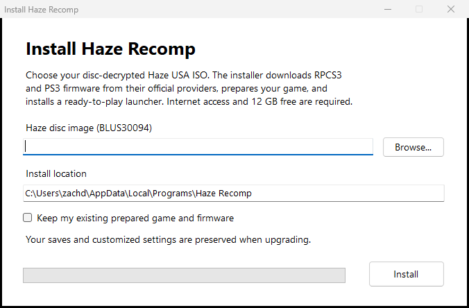
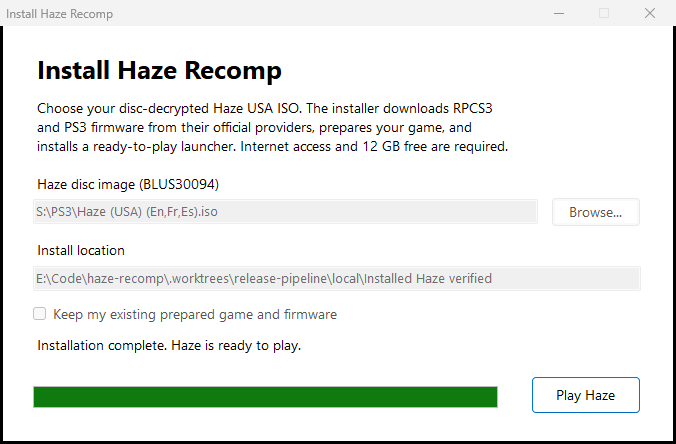

# Haze Recomp

Experimental Windows port of **Haze** for PS3, built with
[ps3recomp](https://github.com/sp00nznet/ps3recomp). Targets the USA disc
**BLUS30094**, disc version **01.02**, application version **01.00**.

The Windows installer prepares your ISO, downloads verified firmware from Sony,
and installs a ready-to-play launcher. It uses a per-user MSI internally. See
[installation and upgrades](docs/installing.md) and the
[automated release process](docs/releasing.md).

Menus, opening-scene gameplay, audio output, and checkpoint saves have been
tested. Keyboard/mouse and SDL controller support are implemented. Performance,
rendering, and campaign compatibility are still in development. Full campaign
completion is not validated. Experimental invite-code campaign co-op has passed
two-instance local gameplay, departure and rejoin tests; separate-machine and
home-router validation is pending. Internet play requires a configured service;
see [co-op setup and limitations](docs/co-op.md). Native PAMF movies
play with synchronized video and audio; Escape or the current confirm binding skips them.

## Install

Run `HazeRecomp-<version>-Setup.exe` from [Releases](https://github.com/zdiemer/haze-recomp/releases),
choose your ISO, and click **Install**. The installer downloads the required
RPCS3 helper and Sony firmware, prepares the game, and installs the launcher.
When it finishes, click **Play Haze**. Subsequent launches use **Haze Recomp**
in the Start menu. No separate tools or development environment are needed.



After the installer prepares the game, the launcher is ready to use:



The tested disc-decrypted image is `Haze (USA) (En,Fr,Es).iso`
(8,498,184,192 bytes), BLUS30094, disc version 01.02 / application version 01.00.
Its **SHA-256** is:

```text
e778fff687b4a122146d23160fe1fefdff14dddb5d5709b257cff76832dc2520
```

Check your image with PowerShell:

```powershell
Get-FileHash -LiteralPath 'D:\PS3\Haze (USA) (En,Fr,Es).iso' -Algorithm SHA256
```

This identifies the tested ISO byte for byte. Setup also checks the disc metadata
and executable hashes; other regions, encrypted raw dumps and updated executables
are unsupported. Supply your own disc image; none is included in releases.

## Build from source

Requires Windows x64, Visual Studio C++ tools with the Windows SDK, Clang,
CMake and Ninja components, Python 3.11+, Git, and 7-Zip. Supply your own
readable (disc-decrypted) game image, RPCS3 executable for EBOOT decryption,
and installed PS3 firmware. Game files and firmware are not included.

Run from the repository root in PowerShell, replacing the example paths:

```powershell
git submodule update --init --recursive
python -m venv .venv
.venv\Scripts\python.exe -m pip install -r external/ps3recomp/requirements.txt

# Extract the disc and decrypt its executable.
.\scripts\extract.ps1 -Iso 'C:\path\to\Haze.iso'
.\scripts\decrypt.ps1 -Rpcs3 'C:\path\to\rpcs3.exe'

# Generate native translations of the game and firmware code.
$env:PS3_DEV_FLASH = 'C:\path\to\dev_flash'
.venv\Scripts\python.exe scripts/haze.py analyze
.venv\Scripts\python.exe scripts/haze.py lift --jobs 4
.venv\Scripts\python.exe scripts/haze.py lift-spu
.venv\Scripts\python.exe scripts/lift_audio_plugins.py
.venv\Scripts\python.exe scripts/lift_firmware.py

.\scripts\build.ps1
# Or double-click build/haze/HazeLauncher.exe after building.
.\scripts\play.ps1
```

**HazeLauncher.exe** starts the game without a scripting console, preserves
save/settings/cache paths and retains session logs. Native dialogs select
missing game or firmware paths; see the [launcher guide](docs/executable-launcher.md).

Already extracted files belong in `game/disc/PS3_GAME/`, including `PARAM.SFO`
and `USRDIR/EBOOT.BIN`. Decryption produces `USRDIR/EBOOT.ELF`. Set
`PS3_DEV_FLASH` again when launching from a new shell, unless firmware is in
`local/tools/rpcs3/dev_flash`.

The PPU lift is an initial translation; additional function recovery may be
needed before a fresh lift boots or runs correctly.

The executable is `build/haze/HazeRecomp.exe`. Saves live in
`local/state/savedata`, session logs in `local/sessions`, and reusable shaders
in `local/cache/rsx-shaders`. Game assets, generated translations, and build
outputs are ignored by Git. The first launch installs about 4 GB of game data.

## Controls and settings

| Action | Default input |
| --- | --- |
| Move / look | WASD / mouse |
| Fire / zoom | Left / right mouse |
| Reload / use | R / E |
| Jump / crouch | Space / Ctrl |
| Switch weapon | X or mouse wheel |
| Grenade / Nectar or play dead | G / Q |
| Melee | F |
| Menu confirm / back | Enter / Esc (Space / X also work) |
| Open / close pause menu | Esc (in nested menus, goes back one page) |
| Release or recapture mouse | F1 |

Menus also support the pointer: left click selects, right click goes back.
Enter and Esc keep their menu actions regardless of gameplay bindings. Holding
either key across a menu boundary cannot trigger another action. Space remains
jump during gameplay; Enter retains the Start binding outside menus by default.
Bindings accept function, numpad and punctuation keys and separate WheelUp /
WheelDown directions; see [docs/control-settings.md](docs/control-settings.md).
SDL gamepads connect automatically. Game vibration plays on the controller in
use, including PlayStation, Switch and Steam virtual pads, while the game window
has focus. Bindings, mouse sensitivity, controller
options, and startup skipping live in [config/input.ini](config/input.ini)
and reload while running. Action names above assume Haze's default controller
layout; zoom and crouch can be changed from toggle to hold in the game's settings.

**Settings > Control Setup** opens PC Controls for bindings, sensitivity,
deadzones, vibration and prompt style. Select a binding to capture an input, review any
conflicts, then **Apply**. **Back** discards edits; **Defaults** requires Apply.
**Game control options** opens the original controller layout and toggle/hold
settings.

**Player Profile** on the main menu shows your current name. Use **Edit profile
name** to type with the keyboard (Enter accepts, Escape cancels), or use **Add
character**, **Delete last character**, and **Clear name** with a controller.
**Apply** saves the name; **Back** discards pending edits. Names use 3–16 ASCII
letters, digits, underscores, or hyphens and must start with a letter. The name
is stored alongside your saves in `player-name.txt`; changing it preserves the
internal profile key, existing save directories, and campaign progression.

The main-menu footer opens **Desktop Options** through the current Select
binding (Tab by default) or a mouse click. **Add to Steam** lets you select a
local account and confirm registration with the executable launcher and artwork;
close Steam first. The pause-menu footer opens **Quit to Desktop** directly.
Quit confirmation defaults to Cancel and waits for active saves and settings
before shutting down.

Open **Video Setup** or **Sound Setup** from the main or pause menu for PC
Video and Audio settings. Changes are staged until **Apply**; **Back** discards
edits. Display changes offer a 15-second **Keep/Revert** confirmation. Render
resolution and shadow resolution require restarting.

Alternatively, edit [config/graphics.ini](config/graphics.ini), then press **F6** to apply
filtering, FXAA, sharpening, exposure, VSync, frame-limit, and performance-overlay changes live.
Editing alone does not apply changes; the window title reports the reload result.
Display mode, monitor, window size, render resolution, and shadow resolution
changes made in the file require restarting.

The Video page offers **Performance overlay** (Off / Compact / Expanded) and
**Overlay position** (four corners). **F7** cycles modes during gameplay or menus
and saves the preference. Compact is a tiny, single-line presentation FPS counter
with a text shadow. Expanded adds mean presentation interval, guest flips (not
simulation rate), draw packets per guest frame,
cached textures, and process working-set RAM. CPU/GPU timings are marked N/A
because the normal renderer does not expose reliable per-frame measurements.
Launch overrides remain in effect after reloading.
Defaults are borderless at the monitor's desktop resolution with a 30 FPS cap.
Override resolution for one run with
`.\scripts\play.ps1 -RenderResolution 1920x1080`.

## Development

Run regression checks with `.\scripts\build.ps1 -Test`, or use
`-RuntimeOnly -Test` for checks without building the game executable.
For a bounded diagnostic run, use `.\scripts\run.ps1 -Seconds 90`;
logs and captures go to `local/runs`.

See the [script guide](scripts/README.md) for diagnostics, microbenchmarks,
build internals and command migrations.

Worktrees can reuse a prepared checkout's SDK, Python environment, generated
translations, and game assets while keeping their own builds and logs:

```powershell
.\scripts\build.ps1 -SharedRoot 'C:\path\to\haze-recomp'
.\scripts\play.ps1 -SharedRoot 'C:\path\to\haze-recomp'
```

Use `-SdkRoot` on the build command to select a separate SDK checkout.
The native build downloads a pinned shared LGPL FFmpeg package for movie
decoding. `-FFmpegRoot` selects an unpacked development package for offline
builds. See [movie playback](docs/movie-playback.md) for formats and validation.

## Experimental browser build

The Wasm64/WebGL2 build supports menus and opening-scene gameplay, but remains
slow and experimental. After preparing the game and translations above, install
Emscripten and run:

```powershell
py -3 scripts/bootstrap-wasm.py
.\scripts\build-wasm.ps1 -Emsdk 'C:\path\to\emsdk'
py -3 scripts/serve-wasm.py --firmware-dir 'C:\path\to\dev_flash'
```

Open <http://127.0.0.1:8085/> in a 64-bit Chromium browser. The build requires
shared memory and about 8 GiB of addressable linear memory; the local server
provides the required isolation headers. Click to enable sound and fullscreen;
F1 releases the mouse. Add `?debug=1` for controls and logs. Browser saves use
IndexedDB, separately from native saves. Browser network play is not implemented.
Native FFmpeg movie playback is not part of the experimental browser build.

Use `scripts/playtest-wasm.py --profile-after 30` with your normal playtest
arguments to record worker CPU profiles. Summarize a run with
`py -3 scripts/diagnose.py browser-cpu local/wasm-tests/<run>`.
The report ranks self samples per worker and shows callers from leaf to root;
`--top`, `--stack-depth`, and `--json` control the output. It also accepts raw
Chromium `.cpuprofile` files. Counts are samples, not elapsed time; idle and wait
functions remain visible, and workers are reported separately.

## License

The port scaffold derives from ps3recomp's MIT-licensed template; see
[LICENSE](LICENSE). Input prompt artwork is by Kenney; its license is included
in [assets/input-prompts](assets/input-prompts).
Native movie decoding dynamically links FFmpeg under LGPLv3. Its license and
documentation are installed under `share/ffmpeg`; the matching shared libraries
remain replaceable beside the executable.
