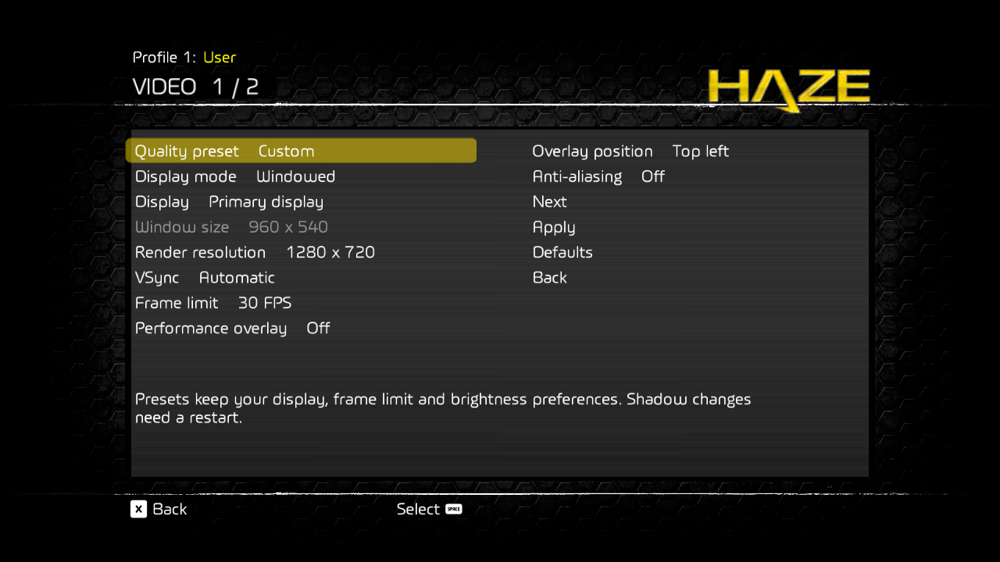
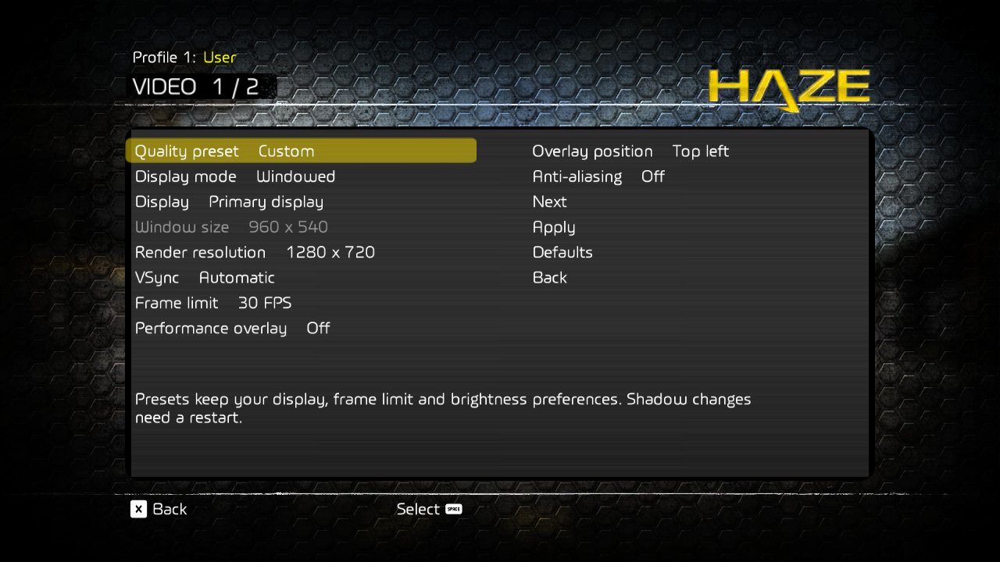

# Native game menus

Issue #73 replaces the separate Win32 settings and Quit panels with Haze GUI
resources on the supported BLUS30094 executable. Video, Audio and Controls use
native text, sliders, toggles, highlights and input prompts. Quit to Desktop and
Add to Steam are separate main-menu rows; the pause menu also has Quit to Desktop.
Confirmation backgrounds use plain brushed metal without hexes.

Player Profile is a main-menu provider with staged name editing, validation,
keyboard text input and native character choices for controllers. Text commands
carry both page generation and modal revision, like other captured input.
The profile name is written atomically to `player-name.txt` in the configured
save root before the published identity changes. Failed writes retain the old
name. System username parameter `0x131` retains the existing internal profile
key; the audited guest display-name field at profile `+0x4d` is refreshed on the
GUI thread. The first local profile is resolved through manager `00f48de0`,
matching `004e6f20(manager, 0)`. The setter instruction guard is `004d31f8`.
The NP ID handler preserves SDK errors and substitutes the display name only
after a successful call. This does not implement authentication or online play.

The obsolete frontend sign-in row `fefl_DC_text7` and initialization label
`fefl_KS_text45` are detached from native child traversal. Removing the row also
removes its layout and navigation slot. Their context registry handles remain
valid for retail callbacks; child ownership is restored before context teardown.

## Presentation and transactions

`haze_menu.cpp` owns window-thread providers and publishes immutable snapshots.
The guest GUI thread constructs and updates native widgets in
`haze_native_menu.cpp`. Commands carry the displayed page generation and modal
revision, so stale events cannot apply settings or confirm a new dialog.

Existing providers still own staged values, Apply/Back, Audio profile saves,
Video preview rollback, Controls capture/conflicts and Steam installation.
Window-close status can temporarily replace a provider's displayed modal while
its pending transaction continues polling. Cancel restores the same provider.
Closing from gameplay requests the native pause page for the status dialog. Escape also cancels waiting/failed shutdown before a native page is available.

Controls has ten settings per section; long choice lists have thirteen entries.
Long confirmation messages are wrapped into four-line pages, including paths
without spaces. Cancel remains available, and confirmation appears on the final
page. The native font size and middle alignment have enough row height for Q/p/y
descenders. Slider steps map to provider units, and On/Off uses the game's
localized strings and native artwork.

## Supported guest boundaries

| Native page | Provider |
| --- | --- |
| `sett_DC_page10` | Video |
| `sett_DC_page3` | Audio |
| `sett_DC_page2` | Controls |
| `fefl_KS_page2` | Main menu / desktop actions |
| `ingm_DC_page1` | Pause menu / quit |

`patch_menu_pages.py` observes `00319C68` after activation completes, including
queued trampoline fragments. `patch_menu_input.py` synchronizes native widgets
after GUI input at `0031B9C0`. The manager's current-context slot at `+48` is only
valid during GUI dispatch. Native calls preserve the complete PPU context and
trampoline, using a private stack area.

Mouse capture and direct camera input use the live local-player GUI contexts,
enumerated by the same fields as guest `004D2D48`, rather than whichever context
was dispatched last. Ownership is published before and after GUI input so page
activation and dismissal clear pending mouse motion promptly. Context destruction
also invalidates the pointer bridge's cached context.

The reusable tutorial page at context `+44` is shared by blocking tutorials and
gameplay tips. `0031A070` sets tutorial widget `+19c` when it blocks the player;
`0031A770` clears that state on dismissal. Only this known tutorial host with
nonblocking tutorial children is exempt from menu ownership. Other pages on the
same stack still block gameplay. Widget handles are resolved with generation
checks, matching `0030CF48`. The camera additionally respects the guest pause
reasons at `0100EAC8`, including pauses that precede GUI dispatch.

The resource parser uses `007AD8D0`, `0078D878`, `0078CE58`, `0078C6C8`,
`0078D6B0`, `0078AB58` and factory `002BC7B0`. Parser input includes two trailing
NUL bytes. Boolean resource values must be quoted. Text release events are
created before their owner and declared in the owner's resource so the native
event array has capacity. One private `callbackWithMenu` dispatcher is registered
through `0030E688`, using gateway `FFFE7300`.

Widgets are pooled under a transparent native host with an opaque brushed-metal
backing behind the rows, values, choices and notices. The backing stops above
the footer so it cannot cover the page's prompts. The prompt bar is attached
directly to the page, as required by its native parent-page lookup. Reused widgets
keep their native layout state; only unused widgets are hidden. Retail children are temporarily detached from traversal because hidden native widgets still update their prompts and animated panels. Original child ownership is restored on Back and before context destruction. Child handles
are installed in reverse visual order with ascending sort keys, matching native
reactivation. Back restores original child flags, localized title mode and page
events. Construction failure restores the retail page and releases input.

`patch_menu_lifetime.py` observes `00317300` before recursive root destruction,
which is shared by context reset (`003173E0`) and destruction (`003174E8`). It
invalidates pooled handles, event bindings and main-menu row identities before
addresses can be recycled. Added event arrays use the native owned-array
allocator `00692068`; the base widget destructor `002F6120` releases them through
`00692010`. The code does not free guest-owned widgets from the host thread.

The page, material and lifetime patchers reject changed or duplicate translated
functions using exact hashes. Their tests check composition with the pointer
patch. The page hook also checks supported guest instructions before dispatch.

## Popup material

`patch_menu_material.py` wraps the native background draw at `002F1538`. After
the original nine-slice background, `haze_native_popup_material` draws subtle
horizontal grain and vertical sheen with native textured quads (`006F5768`).
Coverage is limited to native dialog vtable `DE5CA8` and registered PC page and
popup containers. PC backings and popups use full material alpha; inherited opacity
still follows native menu transitions. Native
text and selection highlights retain their original drawing order.

The material is procedural; no extracted game texture is redistributed. The
existing hex-pattern menu background is not used for the popup interior.

## Validation

Profile-name regressions cover invalid/unsupported names, length limits,
restart persistence, a denied atomic replacement, unchanged campaign files,
keyboard/controller editing, cancellation, stale text commands, guest ABI
errors, and the guarded display-field update. A private-desktop native run with
copied saves entered and saved `Pilot_46`, returned through the menus and exited
normally with the original `_PROFILE.DAT` hash unchanged. A restart loaded the
same save slot and displayed the new name in the main, campaign, and pause
menus. Continuing the campaign reached the saved jungle checkpoint. The private
desktop used a process-local focus stand-in and diagnostic pad input; it did not
switch or send input to the user's desktop. Captures and logs are in ignored
`local/runs/profile-proof-2` and `local/runs/profile-restart`.

For #102, menu keyboard holds use physical samples so a delayed window-message
release cannot keep navigation repeating. Queued keydown timestamps preserve
otherwise missed taps and discard messages for presses already sampled. Focus
loss and native-page handoffs suppress held keys until release. The guest retains
its navigation repeat delay/rate and confirm/back event handling.

The input regression suite covers delayed press/release delivery, buffered taps,
hover handoff, focus suppression, clock wrap, and startup transitions. A native
comparison on isolated desktops used process-local focus and physical-key test
stand-ins: a 100 ms press with its release message delayed by 800 ms moved eight
rows on the baseline and one on the fix. This tests the production mapper and
guest menu together; physical keyboard feel still needs interactive verification.

For #107, the native build and `scripts/test-input.ps1` passed against the
pinned SDK. A private-desktop run with copied saves checked Video, Audio and
Controls over the dark main menu and the bright carrier checkpoint, including
choice lists and footer coverage. The screenshots below include normal text,
the selected Quality preset, and a disabled Window size row (its native enabled
flag was temporarily cleared in the probe, then restored). The settings interior
at pixels `(180,180)` through `(1100,600)` is identical in both captures. Hiding
only the new backing reproduced the bright-scene washout.

The executable builds, and `scripts/test-input.ps1` passes: controller CTests,
provider transactions, input/camera/title/graphics, display preview rollback and
failures, Audio/save coordination, Controls rebinding/conflicts, Steam profile
confirmation, Quit coordination and guest patch guards. Quit regression coverage
includes window close during pending Apply, save failure, Cancel returning to the
same transaction and shutdown before a native page is presented.

Live captures in ignored `local/native-menu-proof` cover distinct main-menu
rows, native settings and choices, Audio slider/toggle changes and persisted
Apply, repeated Audio opening, Controls pagination and uncropped descenders,
plain-metal native/PC popups, all three settings pages from pause, return to play, and main-menu reconstruction after leaving gameplay. Both 1280x720 and 1024x768 were checked. Runtime Steam
checks did not install a shortcut or alter the user's Steam data.

Focused display Keep/Revert and rebinding/conflict behavior are covered by the
automated provider/backend tests; these focus-dependent flows were not exercised
interactively against the user's foreground session. Mouse dispatch retains the
existing native pointer bridge and its automated regression coverage.

For local resource research, `scripts/haze_pak.py` reads version-2 PBCK archives
and extracts selected entries to an explicit destination with content hashes.
It leaves source archives unchanged. Keep extracted game resources in ignored
local storage. `tests/test_haze_pak.py` covers bounds and compressed entries.
